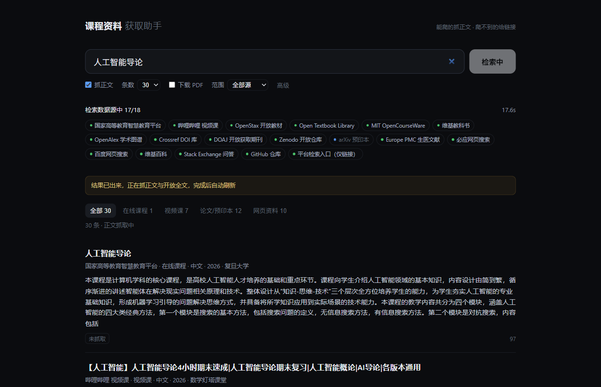
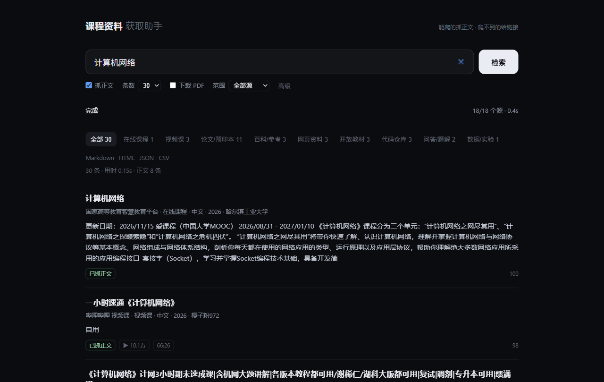

# 课程资料获取助手 · Course Material Finder

一句话：**输入一门课，从全网把能拿的资料拿下来——能爬的直接抓正文，爬不到的平台给你直达链接，并且逐条标清楚哪条是「已抓取」、哪条只是「链接」。**

不是聚合搜索框，是一条完整流水线：

```
查询理解 → 20 个数据源并发检索 → 去重/打分/多样性控制 → 逐条抓正文 → Markdown / JSON / CSV / HTML 报告
```

## 界面

检索中实时可见每个源的状态；**结果先出、正文后补**，12 秒左右就能开始读：



抓完后横幅消失、状态带收起，每条都标注「已抓正文 / PDF 直链 / 被反爬」：



## 为什么不是「套个搜索框」

| 常见做法 | 问题 | 本工具的做法 |
| --- | --- | --- |
| 只调一个搜索引擎 API | 中文课程库、开放教材、预印本全覆盖不了 | 20 个源分四层接入，各自解析器独立 |
| 把搜索结果直接丢给用户 | 用户还得逐条点开、自己判断 | 对前 N 条**真访问页面**，抽标题/摘要/正文前 1200 字 |
| 声称「全网抓取」 | 实际上遇到反爬就静默失败、结果造假 | 每条结果标注 `已抓正文 / PDF 直链 / 被反爬 / 已下载`，源级失败也写进报告 |
| 硬刚付费墙 | 法律风险 | 明确不绕过：登录墙/付费墙/反爬平台只给检索入口 |

## 一键启动（Windows）

双击 **`一键启动.cmd`**（等同 `start.cmd`）就够了：

1. 自动找 Python（`python` 优先，退回 `py -3`）；
2. 缺 `requests` 就自动 `pip install`；
3. 自动挑空闲端口启动本地服务，并打开浏览器。

带参数调用时不弹浏览器，方便脚本化（如 `start.cmd --port 8799`）。

## 网页版

```powershell
python serve.py              # http://127.0.0.1:8765
python serve.py --port auto --open
```

界面只有三样东西：**一个输入框**、**一条看得见每个源在动的状态带**、**一套能直接拿走的导出**（Markdown / HTML / JSON / CSV）。

体验上的两个关键设计：

- **先给结果、后补正文**：12 秒左右先用「已经返回的源」排一版，条目标注「未抓取」；
  正文抓完自动整页刷新，横幅消失、徽标变成「已抓正文」。
- **慢源不阻塞**：arXiv 这类响应可到 60 秒的源不会卡住首屏；超时的源在状态带上标黄并写进报告。

其它：`?q=关键词` 可直接分享检索链接；「高级」里可以多选数据源、调最低相关度和预算。

### 本地 API（想自己接前端时用）

| 接口 | 作用 |
| --- | --- |
| `GET /api/bootstrap` | 数据源清单（含语言/层级/说明） |
| `GET /api/start?q=&limit=&crawl=&download=&sources=&minscore=&budget=` | 建任务，立即返回 `job` id |
| `GET /api/progress?job=` | 阶段、耗时、每个源的状态（轮询用） |
| `GET /api/partial?job=` | 排序完成后的**预览**结果（正文未抓完） |
| `GET /api/result?job=` | 最终结果 + 抓取统计 |
| `GET /api/export?job=&fmt=md\|html\|json\|csv` | 直接下载报告 |
| `GET /health` | 存活检查 |

## 命令行

```powershell
pip install requests                   # 唯一依赖

python find.py "高等数学 期末复习"
python find.py "数据结构 实验" -n 40 --download ./dl
python find.py "linear algebra" --sources openalex,arxiv,ocw --no-crawl
python find.py --list-sources          # 看 20 个数据源
```

产物默认落在 `out/`：

```
out/2026-11-15-0207-高等数学.md     # 给人看：分组清单 + 抓取情况表
out/2026-11-15-0207-高等数学.json   # 给程序用：结构化全量字段
out/2026-11-15-0207-高等数学.csv    # 给表格用
out/2026-11-15-0207-高等数学.html   # 离线可看的卡片页
```

## 数据源矩阵（都是实测过的结论，不是抄文档）

### 第一层：结构化接口（可稳定抓取）

| 源 | 内容 | 语言 | 说明 |
| --- | --- | --- | --- |
| `chinaooc` | 国家高等教育智慧教育平台课程库 | 中 | 教育部官方，含同济/重大等高校慕课详情 |
| `bilibili` | 视频课 | 中 | 需先访问首页拿 `buvid3` cookie，接口才不返回 412 |
| `openstax` | 开放教材 129 本 | 英 | 无搜索接口，全量拉目录后本地匹配，更准 |
| `otl` | Open Textbook Library | 英 | Atom feed，必须显式 `Accept: application/atom+xml` |
| `ocw` | MIT OpenCourseWare | 英 | 无搜索 API，抓 sitemap 索引（2500+ 门课）建本地索引 |
| `wikibooks` / `wikipedia` | 教科书 / 百科 | 中英 | MediaWiki API |
| `openalex` | 2.5 亿学术记录 | 中英 | 摘要用 `abstract_inverted_index` 还原，不用再抓页面 |
| `crossref` / `doaj` / `europepmc` | 期刊 / OA 期刊 / 生医 | 英 | DOI、开放全文链接 |
| `zenodo` | 数据集/代码/讲义 | 英 | 课程实验数据好去处 |
| `arxiv` | 预印本 | 英 | 单次响应可达 40s，已用长超时 + 6h 缓存 |
| `stackexchange` | 问答 | 英 | 按课程自动选站（数学/物理/化学/经济/统计/SO） |
| `github` | 课程笔记/题解仓库 | 英 | 未认证 10 次/分，已做 12h 缓存 |

### 第二层：抓结果页

| 源 | 说明 |
| --- | --- |
| `bing` | 服务端直出 HTML，解析 `b_algo`，覆盖英文/全球 |
| `baidu` | 中文覆盖最广；需 `BAIDUID` cookie 预热，**广告位（`ec-pc-*`）已过滤** |
| `sogou` | 结果页 JS 壳重，抽取率低，默认关闭 |

### 第三层：站点索引

`ocw`、`openstax` 走的就是这条——站点不给搜索接口，但它自己公开了全量索引，本地建索引反而更准更快。

### 第四层：只能给链接（`portals`）

| 平台 | 为什么只给链接 |
| --- | --- |
| 中国大学MOOC、学堂在线、智慧树、超星/学习通 | 纯 JS 渲染 / 大数据服务报错 |
| 百度文库、道客巴巴、豆丁 | 登录墙 + 付费墙 |
| 知网、万方 | 机构权限 |
| CSDN、知乎 | 反爬 + 登录 |
| Google Scholar、YouTube | 验证码 / 需 API key |

这些平台**不做任何绕过**，只生成带关键词的直达检索链接，并在报告里单列一节「仅链接」。

## 命令行参数

| 参数 | 作用 |
| --- | --- |
| `-n, --limit` | 最终条数（默认 30） |
| `-s, --per-source` | 每源取几条（默认 10） |
| `--sources` | 只查指定源，支持别名：`mit`→`ocw`、`b站`→`bilibili`、`zhihu`→`portals` |
| `--exclude` | 排除某些源 |
| `--no-crawl` | 不抓正文，只出链接（快，约 3–5s） |
| `--crawl-limit` | 抓正文条数上限（默认 12） |
| `--download DIR` | 下载找到的开放 PDF |
| `--no-oa` | 不查 Unpaywall 开放全文 |
| `--min-score` | 相关度下限（0–100） |
| `--format` | `md,json,csv,html` 任意组合 |
| `--budget` | 检索总预算秒数（默认 100，到点放弃慢源、照常出报告） |
| `--crawl-budget` | 抓正文预算秒数（默认 60） |
| `--no-cache` | 禁用缓存 |
| `--list-sources` | 列出数据源 |

## 打分逻辑

```
score = 100 × (0.60×相关度 + 0.20×源质量 + 0.10×时效 + 0.10×语言匹配)
```

- **相关度**：查询核心词的 token 覆盖率（标题权重 0.7）。中文用「CJK 二元组 + 停用词表」，避免"任何中文结果都命中"。
- **意图感知**：查「期末 真题」时，一篇《高等数学教学法研究》会被降到 0.45 倍——不是学生要的。
- **源质量**：官方课程库/开放教材 0.9+，搜索引擎 0.52–0.55；GitHub 星数、B站播放量做对数加成，防止一家独大。
- **多样性**：同一数据源最多占 3 条，避免榜单被一类结果刷屏。

## 目录结构

```
course-material-finder/
├── find.py                 # 命令行入口
├── serve.py                # 本地网页版服务（任务 + 进度 + 导出 API）
├── web/                    # 前端：index.html / app.css / app.js（零依赖）
├── start.cmd / 一键启动.cmd  # Windows 一键启动
├── cmf/
│   ├── engine.py           # 并发编排 + 来源状态记录
│   ├── http.py             # 缓存/重试/每主机限速/编码嗅探/cookie 预热
│   ├── query.py            # 中文意图词剥离（后缀式，不切坏课名）
│   ├── rank.py             # 相关度、源质量、意图折扣、去重、多样性
│   ├── enrich.py           # 抓正文、识别 PDF、Unpaywall 补全文、下载
│   ├── report.py           # md/json/csv/html + 终端摘要
│   ├── textutil.py         # HTML→文本、token、URL 归一化
│   └── sources/            # 每个数据源一个类，独立可测
├── tests/                  # 41 个离线测试（真实响应夹具）
├── dev/                    # 数据源探针脚本（换网络环境时重新体检用）
└── out/                    # 报告输出
```

## 加一个新数据源（三件事）

```python
# cmf/sources/mysource.py
class MySource(Source):
    meta = SourceMeta(id="mysource", label="我的源", kind="course", lang="zh", tier="api", ttl=3600)

    def fetch(self, q, ctx):
        data = ctx.http.get_json("https://api.example.com/search", params={"kw": q.core}, ttl=self.meta.ttl)
        return [self.make(title=it["title"], url=it["url"], description=it["desc"]) for it in data["items"]]
```

然后到 `cmf/sources/__init__.py` 的 `_INSTANCES` 里加一行，再往 `tests/fixtures/` 丢一份真实响应写个解析测试。

## 抓取礼仪与合规

- 每个源单独限速（百度 2.0s、必应 1.5s、GitHub 6.5s、arXiv 3.0s…），并发不超过 8。
- 默认磁盘缓存（`.cmf-cache/`），重复查询不打上游。
- 只访问**公开可访问**页面与公开接口；不登录、不破验证码、不绕付费墙、不碰盗版资源站。
- 引用请遵守各平台授权：MIT OCW 为 CC BY-NC-SA，OpenStax 多为 CC BY。

## 已知限制（如实写）

| 限制 | 原因 | 现状 |
| --- | --- | --- |
| 学堂在线、中国大学MOOC 无正文 | 接口需签名/大数据服务报错 | 归入 `portals`，给检索链接 |
| `gutendex` 默认关闭 | 实测多次 60s 超时 | 需要时 `--sources gutendex` |
| arXiv 慢 | 上游响应 1–45s 波动 | 60s 超时 + 6h 缓存 |
| 百度偶发验证页 | 风控 | 自动降级，报告标为失败源，不影响其它源 |
| PDF 正文未解析 | 不引入重依赖 | 识别 + 可下载，正文靠在线预览 |
| 语义改述召回弱 | 用 token 覆盖而非向量 | 换更通用的课程名可缓解 |
| 慢源会拖时间 | 个别接口响应可达分钟级甚至卡在 DNS | **守护线程 + 总预算**：到点放弃该源并在报告标注，进程不会挂死 |

## 测试

```powershell
python -m unittest discover -s tests -p "test_*.py" -v
```

41 个用例全部离线（`tests/fixtures/` 里是真实抓到的响应），覆盖：查询解析、HTML→文本、URL 归一化、排序去重、并发预算、13 个源的解析器、报告渲染。

## 排错

| 现象 | 处理 |
| --- | --- |
| 全部源失败 | 先 `python dev/probe_sources.py` 体检网络与各接口 |
| 结果太少 | `--sources all --min-score 5 -s 20`，或用更通用的课程名 |
| 中文查询结果偏空 | 中文源只有 `chinaooc/bilibili/baidu/portals`，其余是英文库 |
| 想更快 | `--no-crawl --no-oa`（3–5s 出结果） |
| 网页版端口占用 | `python serve.py --port 8801` |
